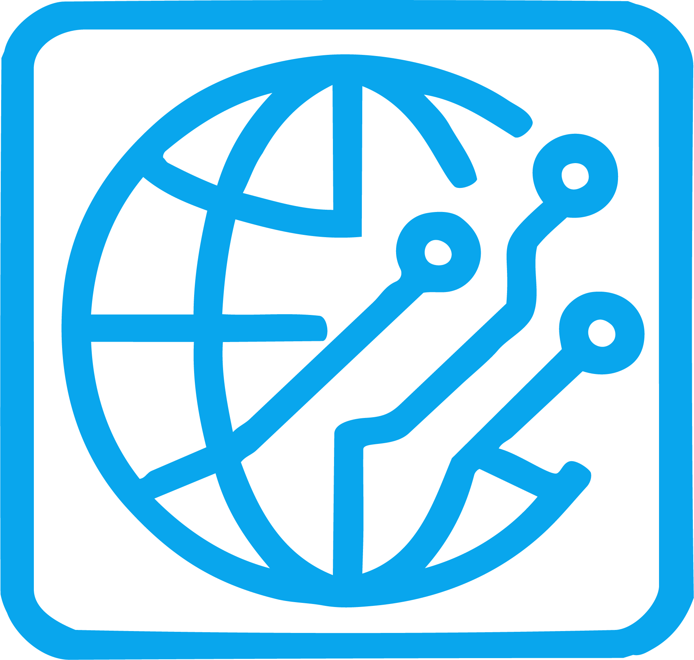

<div align="center">



# Grupo ISCIA | Soluciones Informáticas

**Sitio web corporativo de servicios web e informáticos**

[🌐 Ver sitio en línea](https://www.grupoiscia.com) · [🛒 Tienda](https://tienda.grupoiscia.com) · [💬 WhatsApp](https://wa.me/529932581296)


</div>

---

## 📖 Descripción

Este repositorio documenta la creación y estructura del sitio web de **Grupo ISCIA**, empresa dedicada al soporte técnico, mantenimiento y reparación de equipos de cómputo, redes, seguridad informática, hosting y soluciones empresariales (incluyendo **CONTPAQi®**).

El sitio tiene un enfoque **B2B**: transmitir confianza, prevención de fallas y continuidad operativa, con llamadas a la acción claras para solicitar servicio, contactar por WhatsApp o agendar una asesoría.

## 🎯 Objetivos del proyecto

- Presentar los servicios de la empresa de forma clara y profesional.
- Generar prospectos mediante formularios y contacto directo por WhatsApp.
- Promocionar el servicio de **hosting** con comparativo de planes.
- Ofrecer una **tienda en línea** en un subdominio independiente.
- Lograr un diseño **responsivo** (escritorio, tablet y móvil).
- Cumplir con transparencia de privacidad (aviso y consentimiento de cookies).

## 🧭 Secciones del sitio

| Sección | Ruta | Descripción |
|---|---|---|
| Inicio | `/` | Hero, servicios, experiencia, estadísticas y contacto |
| CONTPAQi® | `/contpaqi/` | Implementación, configuración, capacitación y soporte |
| Redes | `/redes/` | Servicios de redes e infraestructura |
| Seguridad | `/seguridad/` | Seguridad informática y protección de datos |
| Pólizas de servicio | `/polizas/` | Planes de soporte corporativo |
| Hosting | `/hosting/` | Planes de hosting y tabla comparativa |
| Nosotros | `/nosotros/` | Información de la empresa |
| Contacto | `/contacto/` | Datos y formas de contacto |
| Política de privacidad | `/politica-privacidad/` | Aviso de privacidad |
| Tienda | `tienda.grupoiscia.com` | Tienda en línea (subdominio) |

## ✨ Características principales

- **Menú tipo cápsula** con submenú desplegable de *Servicios*.
- **Hero** con mensaje de valor, botones de acción y checklist de beneficios.
- **Contadores animados** (clientes atendidos, años de experiencia, servicios).
- **Tarjetas de servicios** con CTA individual hacia formulario o WhatsApp.
- **Bloque CONTPAQi®** con distintivo de distribuidor autorizado.
- **Proceso en 3 pasos**: Diagnóstico → Propuesta → Servicio.
- **Botón de WhatsApp** con mensaje precargado según la sección.
- **Banner y panel de cookies** configurable (necesarias, Google Analytics y Meta Pixel).
- **Diseño responsivo** adaptado a PC, tablet y móvil.
- **URLs amigables** sin extensión `.html` / `.php`.

## 🛠️ Tecnologías

- **HTML5** y **CSS3** (hoja de estilos unificada `style.css`)
- **JavaScript** (menú, animaciones, contadores y gestión de cookies)
- **PHP** (plantillas y lógica del servidor)
- **Apache** con `.htaccess` para reescritura de URLs
- **cPanel** como entorno de hosting
- **Google Analytics** y **Meta Pixel** (según consentimiento del usuario)

## 🎨 Identidad visual

- Paleta **B2B**: azul marino como color principal, fondos blancos y gris claro, acento naranja para botones principales y verde para WhatsApp.
- Tipografías: **Montserrat / Poppins** en titulares e **Inter / Roboto** en texto.
- Logos de **CONTPAQi® Distribuidor Autorizado** y **Microsoft Partner**.

## 📁 Estructura del proyecto

Cada página `.php` vive en su propia carpeta para obtener URLs limpias (`/hosting/` en lugar de `/hosting.html`).

```
grupoiscia/
├── index.php
├── .htaccess
├── style.css            # Hoja de estilos unificada
├── js/
│   └── main.js
├── img/
│   ├── logo.png
│   ├── blanco.png
│   └── contpaq.jpeg
├── contpaqi/
│   └── index.php
├── redes/
│   └── index.php
├── seguridad/
│   └── index.php
├── polizas/
│   └── index.php
├── hosting/
│   └── index.php
├── nosotros/
│   └── index.php
├── contacto/
│   └── index.php
└── politica-privacidad/
    └── index.php
```

> Ajusta el árbol si tu repositorio difiere de esta estructura.

## 🔗 URLs amigables con `.htaccess`

El sitio migró de enlaces con extensión (`.html`) a URLs limpias. Ejemplo base de reglas:

```apache
RewriteEngine On

# Forzar HTTPS
RewriteCond %{HTTPS} off
RewriteRule ^(.*)$ https://%{HTTP_HOST}/$1 [R=301,L]

# Redirigir .html y .php a la URL sin extensión
RewriteCond %{THE_REQUEST} \s/+(.+?)\.(html|php)[\s?] [NC]
RewriteRule ^ /%1/ [R=301,L]

# Servir carpetas con index.php
DirectoryIndex index.php index.html
```

## 🚀 Instalación y despliegue

### Requisitos

- Servidor Apache con `mod_rewrite` habilitado
- PHP 7.4 o superior
- Hosting con cPanel (recomendado)

### Pasos

1. Clona el repositorio:
   ```bash
   git clone https://github.com/<tu-usuario>/<tu-repositorio>.git
   ```
2. Sube el contenido a `public_html` mediante el Administrador de archivos de cPanel o FTP.
3. Verifica que el archivo `.htaccess` se haya copiado (es un archivo oculto).
4. Configura tus identificadores de Google Analytics y Meta Pixel.
5. Abre el dominio y comprueba que las URLs amigables funcionen.

### Desarrollo local

```bash
php -S localhost:8000
```

Después abre `http://localhost:8000` en el navegador. Nota: el servidor integrado de PHP no interpreta `.htaccess`; para probar las reglas de reescritura usa XAMPP, Laragon o similar.

## 🍪 Privacidad y cookies

El sitio incluye un banner de consentimiento con tres categorías:

- **Necesarias**: siempre activas.
- **Google Analytics**: estadísticas de uso del sitio.
- **Meta Pixel**: medición de campañas publicitarias.

Los scripts de analítica y publicidad solo deben cargarse cuando el usuario los acepta.

## 🔒 Seguridad

- No subas al repositorio credenciales, contraseñas ni datos de conexión a bases de datos.
- Usa archivos de configuración excluidos con `.gitignore` (por ejemplo `config.php`).
- Mantén HTTPS forzado y revisa periódicamente los permisos de archivos en el servidor.

## 🗺️ Historial de evolución

1. Sitio original en `.html` con múltiples hojas de estilo.
2. Migración a **URLs amigables** y estructura de una carpeta por página.
3. Unificación de todos los `.css` en un único `style.css`.
4. Rediseño visual con identidad **B2B** (azul marino, acentos naranja/verde).
5. Rediseño de la sección de **Hosting** con comparativo de planes, garantía y preguntas frecuentes.
6. Correcciones de navegación responsiva en tablet y móvil.
7. Incorporación de banner de cookies y política de privacidad.

## 📞 Contacto

**Grupo ISCIA – Servicios web e informáticos**

- 🌐 Sitio: [www.grupoiscia.com](https://www.grupoiscia.com)
- 📧 Correo: ventas@grupoiscia.com
- 📱 Teléfono / WhatsApp: 993-258-1296
- 🕘 Horario: Lunes a viernes de 09:00 a 18:30 h · Sábado de 09:00 a 14:30 h
- Redes: [Facebook](https://www.facebook.com/grupoiscia) · [X](https://www.x.com/grupoiscia) · [LinkedIn](https://www.linkedin.com/in/grupoiscia)

## 📄 Licencia

© 2019 – 2026 **Grupo ISCIA**, marca registrada. Todos los derechos reservados.

Este repositorio documenta un sitio comercial; el código, los logotipos y los contenidos no pueden reutilizarse sin autorización de Grupo ISCIA.
